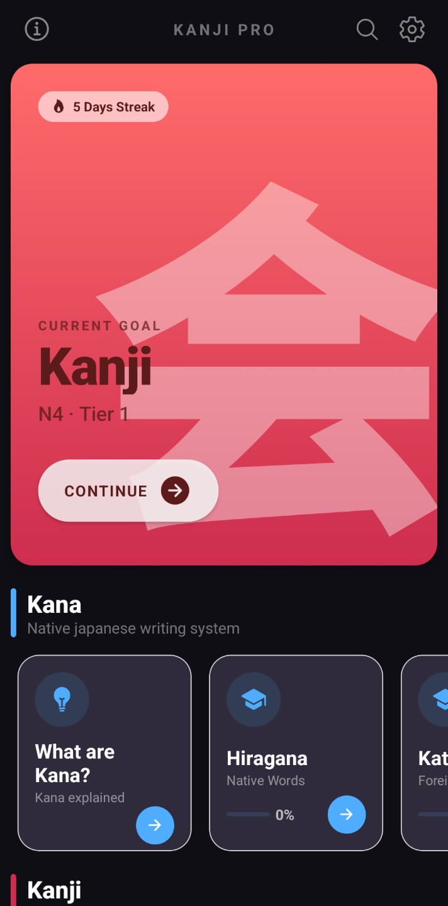
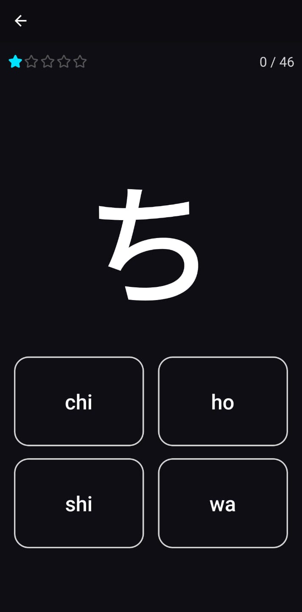
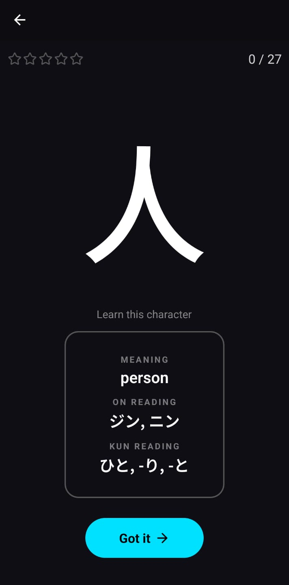
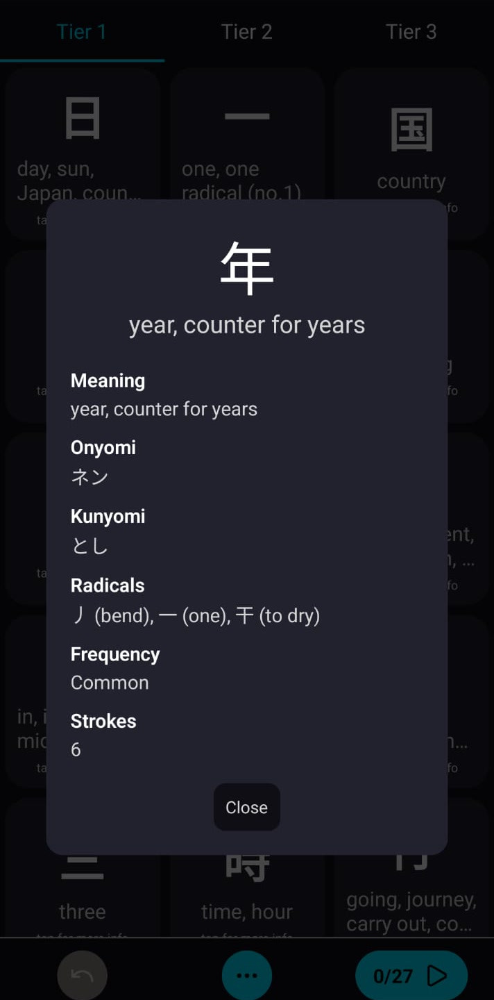
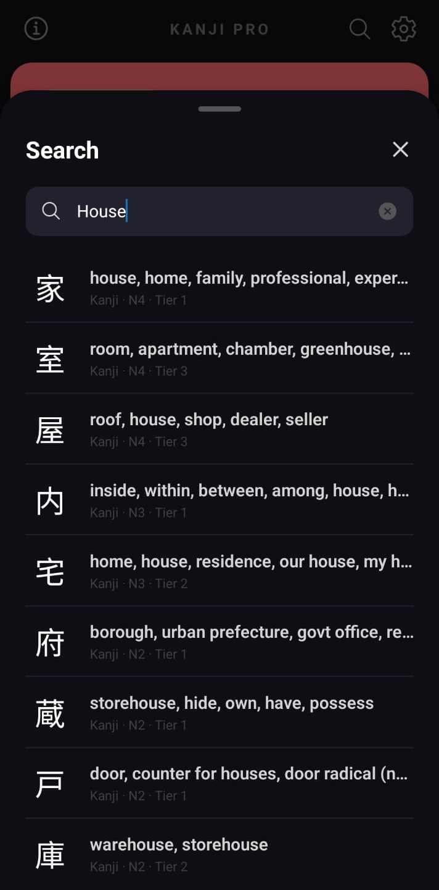
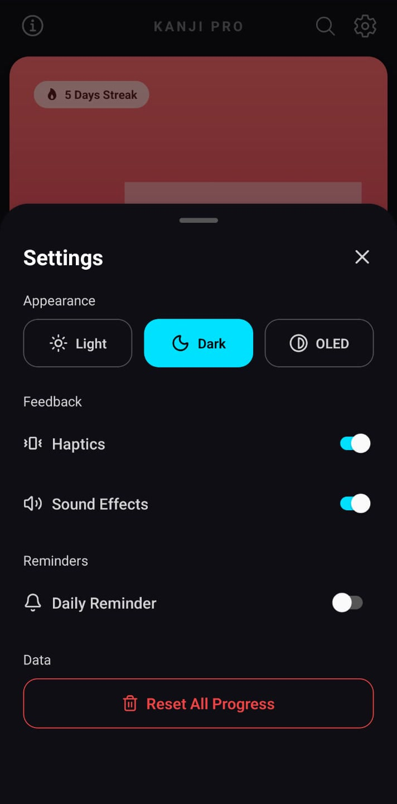

<div align="center">


# Kanji Pro

**Learn Japanese kana, kanji, and radicals.**

A clean, offline-friendly Japanese study app for Android, built with Expo and React Native.
Drill hiragana and katakana, work through kanji from N5 to N1, and master the
radicals that make them up, with a spaced, star-based mastery system.

</div>

## Screenshots

<div align="center">

| Home | Quiz | Learning Mode |
| :--: | :--: | :--: |
|  |  |  |

| Kanji Info | Search | Settings |
| :--: | :--: | :--: |
|  |  |  |

</div>

## Features

- **Full kana coverage**: Hiragana and katakana, basic sets plus variants and combinations.
- **Kanji N5 → N1**: 2,000+ kanji with meanings, on'yomi/kun'yomi readings, and the radicals each one is built from.
- **Radicals**: learn the building blocks and see them annotated inside every kanji.
- **Star-based mastery**: each character earns stars as you get it right and counts as "learned" at 6 stars. Keep answering it correctly to collect bonus stars ("+N").
- **Smart question pool**: unmastered items are prioritised, and mastered ones return for review now and then, the shaky ones (few bonus stars) more often than the solid ones. A wrong answer on a mastered character puts it back into rotation.
- **Learning Mode**: teaches a few characters at a time and shows each new one with its answer first, so you learn before you're tested. You can toggle it on/off in Quiz Settings.
- **Two input modes**: multiple-choice buttons or a built-in QWERTY keyboard that accepts romaji for kana readings.
- **Multiple question types for kanji**: quiz on meanings, on/kun-readings, or a mix.
- **Quality-of-life touches**: haptics, sound effects, light/dark/OLED themes, streak tracking, daily reminder, and search across the whole database.
- **Feedback without an account**: send bugs and ideas straight from the app (About → Send feedback).

## Installation

[](https://apps.obtainium.page/redirect?r=obtainium://app/%7B%22id%22:%22dev.Kairos-Akil.Kanji-Pro%22,%22url%22:%22https://github.com/Kairos-Akil/Kanji-Pro%22,%22author%22:%22Kairos-Akil%22,%22name%22:%22Kanji-Pro%22%7D)

Or download the APK from [Releases](https://github.com/Kairos-Akil/Kanji-Pro/releases).

> **Updating from 1.2.1 or older?** Starting with 1.3.0, the app is signed with a new key, so
> Android won't install it over an older version. Simply uninstall the old version before installing
> the new one. Your progress from previous versions won't carry over.

### Verifying the APK

Every release is signed with my key. Its certificate fingerprint (SHA-256) is:

```text
79b3d40c854075bcaaee40c18793067a28229ce801a929f472bb43175d424e81
```

You can check a downloaded APK with `apksigner verify --print-certs app-release.apk`
(from the Android SDK build tools). If the fingerprint differs, the APK isn't from me.

---

## Tech Stack

- [Expo](https://expo.dev/) SDK 58 & [Expo Router](https://docs.expo.dev/router/introduction/) (file-based routing)
- [React Native](https://reactnative.dev/) 0.88 · React 19 · New Architecture enabled
- [React Native Reanimated](https://docs.swmansion.com/react-native-reanimated/) for animations
- [AsyncStorage](https://react-native-async-storage.github.io/async-storage/) for offline progress persistence
- [Ionicons](https://ionic.io/ionicons) and [lucide-react-native](https://lucide.dev/) icons
- [Jest](https://jestjs.io/) tests for the quiz logic and progress saving
- Dictionary data from **KANJIDIC2** and **KRADFILE-U**

---

## Getting Started

**Prerequisites:** [Node.js](https://nodejs.org/) 22 or newer. To build APKs you also need the
Android SDK and a JDK 17.

```bash
# Install dependencies
npm install

# Start the dev server
npm start

# Run the tests and the linter
npm test
npx eslint .
```

Then press `a` for Android or `w` for the web build, or scan the QR code with the Expo Go app.

### Building an APK

Build scripts live in `scripts/` and are wired into npm. They regenerate the native `android/`
project when needed.

```bash
npm run build:debug   # debug APK, works for anyone
npm run build:dev     # release APK (what I publish), needs my signing key
npm run build:prod    # release .aab bundle for the Play Store, needs my signing key
```

Release builds are signed with my own key (see `plugins/withReleaseSigning.js`) and stop with an
error if it isn't set up. To build the app yourself, use `npm run build:debug`.

To prepare a new version, `npm run bump` raises the version number in every place it's stored.

---

## Data & Licence

Kanji and radical data is derived from the **KANJIDIC2** and **KRADFILE-U**
dictionary files, property of the [Electronic Dictionary Research and Development
Group (EDRDG)](https://www.edrdg.org/), and used under the **Creative Commons
Attribution-ShareAlike 4.0** licence. See the
[EDRDG licence](https://www.edrdg.org/edrdg/licence.html) for details.

---

## Support

Kanji Pro is a solo passion project.

There's no way to support the project financially right now. If enough people end up using it, I might add one in the future.

For now, a star on the repository is the best way to support the project. Thanks!

---

## Licence

This project is licensed under the GNU General Public License v3.0 (GPL-3.0). See the [`LICENSE`](./LICENSE) file for details.
Dictionary data retains its original CC BY-SA 4.0 licence as noted above.

## About

I started building Kanji Pro because I wanted to learn kanji myself, but I couldn't find an app that matched what I was looking for.

Most apps felt overly complex or cluttered with features I didn't need. I wanted something simple, clean, and focused on learning kanji without unnecessary distractions. That idea became the foundation for Kanji Pro.

This is also my first app and my first larger programming project, so if you have any feedback, suggestions, or find a bug, I'd love to hear from you. Even if you just give the app a try, I really appreciate it.
